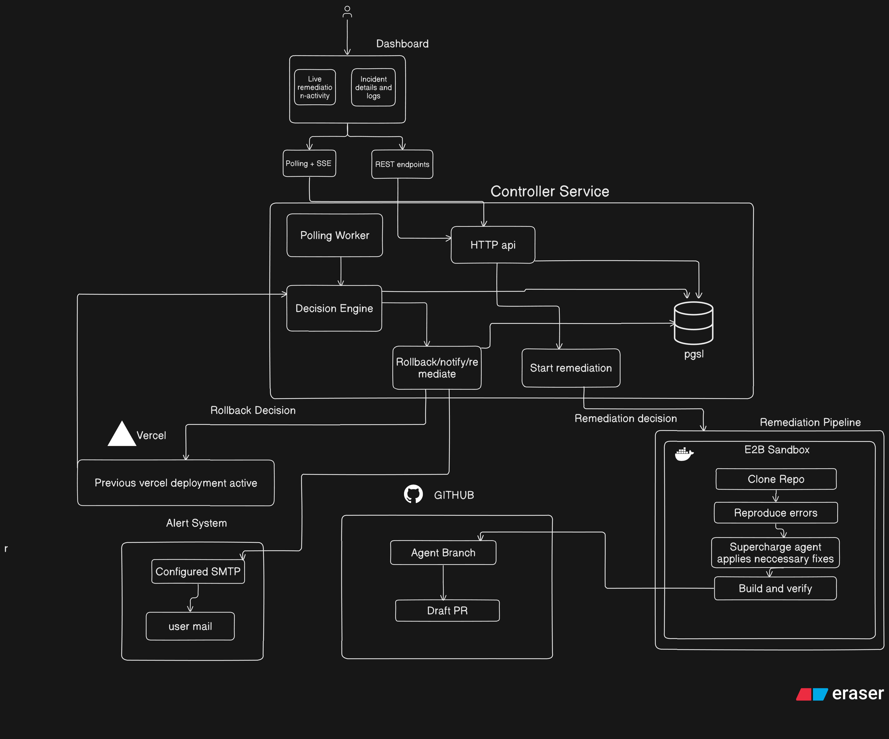

# Sentinel AI

https://github.com/user-attachments/assets/3f8fb72b-176f-460a-bfea-b62a0465d290


Sentinel is a incident-response control plane for a separately deployed
web application. It checks application health and deployment status, records
evidence, and chooses a guarded response: roll back a recent production
regression, prepare a tested draft pull request for a persistent defect or
failed build, and investigate the repository when rollback evidence is inconclusive. A local web dashboard
shows incidents and remediation activity; notifications can be delivered by
Slack or SMTP.

The repository includes a deliberately breakable sample application for
demonstrations. It is not the dashboard and should not be treated as a
production target.

## Project status and scope

The codebase contains working controller, dashboard, sample-app, and shared
package implementations. Monitoring, rollback, and AI remediation are disabled
by default and require explicit configuration. This is a project-scoped demo
and operator-assistance tool, not a general-purpose monitoring service:

- The controller monitors configured services on a polling schedule; it does
  not ingest a continuous Datadog or Sentry event stream.
- Supported deployment providers are Vercel, Railway, Render, and Coolify.
- Automatic rollback is guarded by project configuration, deployment identity,
  probe results, and a one-attempt-per-deployment claim. Enable it only for a
  dedicated demo service you control.
- Remediation runs in an E2B sandbox and can publish a **draft** GitHub PR only
  after reproduction and validation checks. It does not merge PRs.
- The dashboard and controller are designed to run in a trusted local or
  private environment. Do not expose the controller to the public internet.

## Architecture


### Main components

| Component | Responsibility |
| --- | --- |
| `apps/controller` | Bun HTTP API, dashboard authentication, polling worker, provider adapters, incident decisions, actions, PostgreSQL persistence, settings, and agent activity streaming. |
| `apps/dashboard` | Next.js and React incident UI, login/setup screens, API client, and live remediation activity. It reads incidents through the controller; it does not initiate agent runs from the browser. |
| `apps/sample` | Standalone Next.js app (`TaskFlow`) used as the monitored target and to rehearse healthy, runtime-regression, and persistent-failure scenarios. |
| `packages/contracts` | Shared incident/event types and the controller/remediator data boundary. |
| `packages/remediator` | E2B-based fix workflow: clone a configured repository revision, reproduce the failure, produce and validate a patch, then optionally publish a draft PR from the controller environment. |
| `packages/notifier` | Redacted incident report formatting and Slack/SMTP delivery. Notification failures are recorded separately from recovery actions. |

### Incident flow and safeguards

1. The worker probes the configured production route (30 seconds by default)
   and periodically checks deployment status (60 seconds by default). It can
   retrieve bounded deployment-log evidence.
2. The controller tracks consecutive failures for the same project,
   deployment, and probe path. It requires three failures before runtime action.
3. Before considering rollback, it verifies the current production deployment,
   checks that it is recent and allowlisted, and probes the immediate
   predecessor on the same route.
4. A fresh regression with a healthy predecessor can take the guarded rollback
   path, followed by bounded recovery verification. A failed build or defect
   that also affects the predecessor goes to the fix-PR path instead.
5. Missing or conflicting rollback evidence routes the incident to repository
   investigation and a verified fix PR. A passing generic reproduction test
   lets the agent create an incident-specific regression check. Failed fix
   attempts report their concrete errors and can retry automatically; the
   controller prevents a second rollback attempt for the same deployment.
6. The dashboard shows incident history and safe agent progress. Notifications
   contain concise redacted summaries. No path automatically merges code.

Vercel note: after a production rollback, automatic production-domain
assignment can be disabled until a human promotes a repaired deployment.

## Repository layout

```text
nexathon/
├── apps/
│   ├── controller/
│   │   ├── src/                 # API, auth, worker, monitor, providers, actions
│   │   ├── tests/               # Controller unit and integration-oriented tests
│   │   ├── .env.example         # Local configuration template (no real secrets)
│   │   └── README.md            # Controller-specific run and configuration notes
│   ├── dashboard/
│   │   ├── src/                 # Next.js pages, UI, API hooks, fixtures and styles
│   │   ├── tests/               # Dashboard parsing/activity tests
│   │   ├── public/              # Static assets
│   │   ├── DESIGN.md            # UI design reference
│   │   └── PRODUCT.md           # Product reference
│   └── sample/
│       ├── src/app/             # TaskFlow UI and health/tasks API routes
│       ├── src/lib/             # Sample task data and helpers
│       ├── tests/               # Sample API tests
│       ├── vercel.json          # Vercel runtime configuration
│       └── README.md            # Sample app, fault modes and deploy steps
├── packages/
│   ├── contracts/src/           # Shared TypeScript contracts
│   ├── notifier/src/            # Report formatting and Slack/SMTP transports
│   └── remediator/
│       ├── src/                 # E2B runner, validation, activity, PR publisher
│       ├── tests/               # Remediator validation/activity tests
│       ├── fixtures/            # Rehearsal-only regression fixtures
│       └── e2b-template/        # Custom sandbox image definition
├── docs/                        # Demo guide and presentation material
├── scripts/                     # Demo scripts
├── docker-compose.yml           # Controller container service
├── Dockerfile                   # Controller production image
├── package.json                 # Bun workspace and root scripts
└── bun.lock                     # Bun dependency lockfile
```

Generated directories such as `node_modules`, `.next`, and build output are not
source; the tree above omits them.

## Requirements

- [Bun](https://bun.sh/) 1.3.11 or later (the root workspace pins 1.3.11)
- PostgreSQL for persistent controller state
- Node.js 20.9 or later when building/running the Next.js apps in environments
  that require Node
- Optional service-specific credentials for monitoring/rollback, E2B and model
  credentials for AI remediation, GitHub credentials for draft PR creation, and
  Slack or SMTP configuration for notifications

## Local development

### 1. Install workspace dependencies

From the repository root:

```sh
bun install
```

### 2. Configure and start the controller

Copy `apps/controller/.env.example` to `apps/controller/.env`, then configure
at least:

- `DATABASE_URL` with a PostgreSQL connection string
- `DASHBOARD_USERNAME` and `DASHBOARD_PASSWORD` for dashboard login
- `DASHBOARD_AUTH_SECRET` with a private random value
- `CONTROLLER_HOST=127.0.0.1` and `CONTROLLER_PORT=8787` for local development

The controller creates its tables at startup. From the repository root:

```sh
bun run --cwd apps/controller start
```

The API listens at `http://127.0.0.1:8787` by default. Monitoring,
rollback, and remediation stay disabled unless explicitly enabled in the
controller environment. For monitoring, also configure exactly one provider
using the corresponding variables in `.env.example`; do not enable rollback
until project and token scopes have been verified on a disposable demo service.

### 3. Start the dashboard

In another terminal:

```sh
bun run --cwd apps/dashboard dev
```

Open `http://127.0.0.1:5173` and sign in with the controller dashboard
credentials. The dashboard's Next.js rewrite targets
`http://127.0.0.1:8787` by default. If you change the controller port, set
`CONTROLLER_API_URL` in `apps/dashboard/.env.local` to the controller's
localhost origin.

For an offline UI rehearsal, set `NEXT_PUBLIC_DATA_MODE=fixtures` in the
dashboard environment before starting it. The root `demo:rehearsal` script
starts the dashboard in fixture mode:

```sh
bun run demo:rehearsal
```

### 4. Run the sample target

In another terminal:

```sh
bun run --cwd apps/sample dev
```

The sample app runs on `http://localhost:3000`. Its probe endpoints are
`/api/health`, `/api/tasks`, and `/api/tasks/summary`. `DEMO_FAULT_MODE` can be
set in the sample app's environment to `healthy` (default), `runtime`, or
`persistent`; restart the app after changing it. These deterministic fault
modes are for the isolated sample target only.

For full Vercel configuration and safe fault-rehearsal steps, see
[`apps/sample/README.md`](./apps/sample/README.md).

## Tests, type checks, and builds

Run a package's tests from the repository root:

```sh
bun run --cwd apps/controller test
bun run --cwd apps/dashboard test
bun run --cwd apps/sample test
bun run --cwd packages/notifier test
bun run --cwd packages/remediator test
```

Type-check packages that define a typecheck script:

```sh
bun run --cwd apps/controller typecheck
bun run --cwd apps/dashboard typecheck
bun run --cwd apps/sample typecheck
bun run --cwd packages/notifier typecheck
bun run --cwd packages/remediator typecheck
```

The sample app also provides `lint` and `build` scripts:

```sh
bun run --cwd apps/sample lint
bun run --cwd apps/sample build
```

Remediator E2B smoke/rehearsal commands and their credential requirements are
documented in [`packages/remediator/README.md`](./packages/remediator/README.md).

## Controller API overview

The dashboard uses these controller endpoints:

- `GET /api/incidents` and `GET /api/incidents/:id` — incident list and detail
- `GET /api/agent/runs` and `GET /api/agent/runs/:id` — local agent-run history
- `GET /api/agent/runs/:id/events` — server-sent event stream of safe progress
- `GET /api/auth/session`, `POST /api/auth/login`, and
  `POST /api/auth/logout` — dashboard session
- `GET /api/settings` and `POST /api/settings` — controller configuration

Starting an agent run is a controller-side operation, not a dashboard action.
`POST /api/internal/agent-runs` requires the local `NEXATHON_RUN_TOKEN` bearer
token and rejects requests carrying an `Origin` header. The CLI entry point is
`bun run --cwd apps/controller start:run`; see the controller README for
rehearsal and real-run requirements.

## Deployment and operations

`Dockerfile` builds the controller image. `docker-compose.yml` publishes port
8787 and expects `apps/controller/.env`; it also sets the controller bind
address to `0.0.0.0` inside the container. Treat the host-published port as
trusted-network access and configure dashboard authentication and secrets
before starting it. PostgreSQL is external; Compose does not start a database.

Settings entered in the dashboard are stored by the controller and require a
controller restart to take effect. Secret settings are not returned to the
dashboard. Keep `.env` files, provider tokens, model keys, GitHub credentials,
and notification webhooks out of version control.

For component-specific details, see:

- [`apps/controller/README.md`](./apps/controller/README.md)
- [`apps/dashboard/README.md`](./apps/dashboard/README.md)
- [`apps/sample/README.md`](./apps/sample/README.md)
- [`packages/contracts/README.md`](./packages/contracts/README.md)
- [`packages/notifier/README.md`](./packages/notifier/README.md)
- [`packages/remediator/README.md`](./packages/remediator/README.md)
- [`docs/demo.md`](./docs/demo.md)
